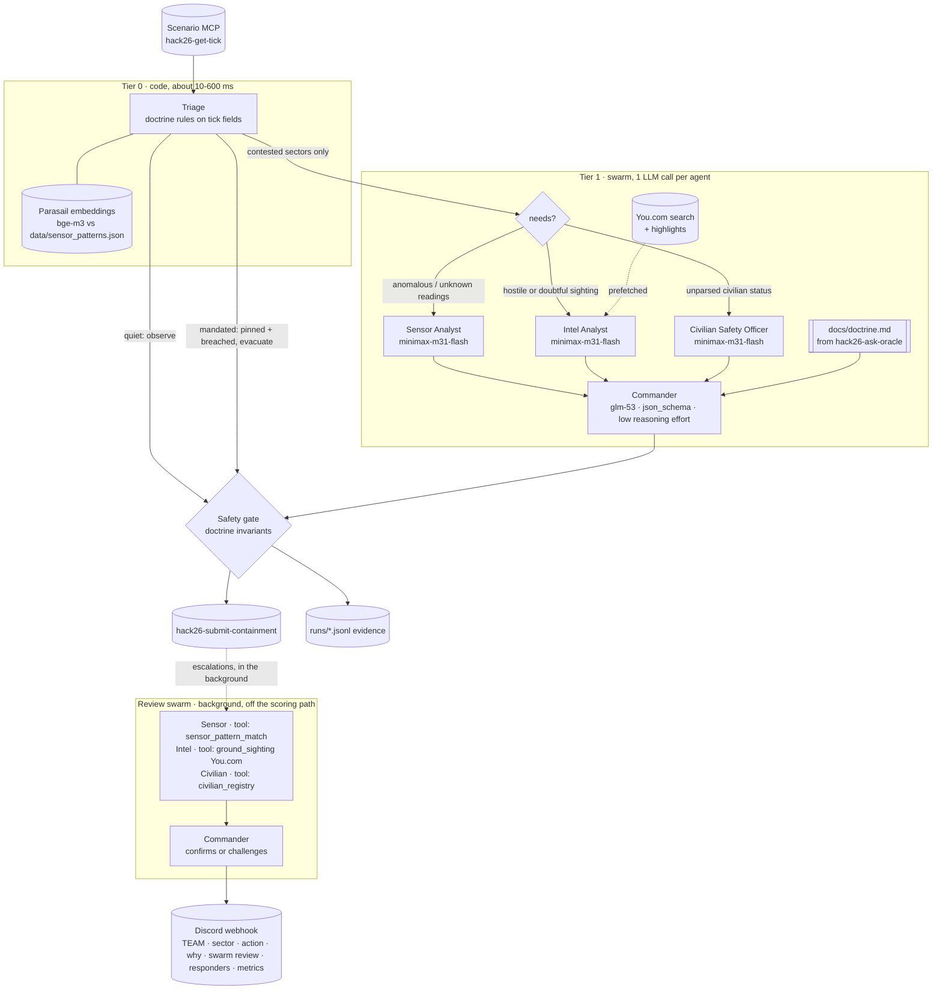

# Halloween Swarm: The Exorcism Protocol

A CrewAI swarm that pulls incident ticks from the scenario MCP feed and decides **contain**, **evacuate** or
**observe** for every sector, submits one action per tick, and posts to the venue Discord webhook only when a real
hazard trips.

The design rule: **code settles what doctrine already settles, and LLMs are used only where judgment is needed.**
Every tick is first triaged in code (with Parasail embeddings). Only contested sectors go to the swarm, and only
to the specialists that sector actually needs. Each agent makes exactly one LLM call, with its evidence already
fetched into the prompt.

## Architecture



**Tier 0: triage in code** ([triage.py](src/halloween_swarm/triage.py)). One batched embeddings call scores every
sector's readings against the labelled reference patterns. Then:

- **mandated**: pinned civilians in a breached sector → evacuate and escalate (doctrine 1). No LLM.
- **quiet**: no hostile sighting, holding, civilians clear and embedding threat below 0.4 → observe (doctrine 3/5).
  No LLM. A sensor fault (an EMF spike with normal temperature and no motion) lands here, because it matches the "sensor fault" pattern.
- **contested**: anything else → the swarm, with a list of which specialists the doubt calls for.

**Tier 1: the swarm, contested sectors only** ([crew.py](src/halloween_swarm/crew.py), [flow.py](src/halloween_swarm/flow.py)).
Each specialist sees only its slice, for only the contested sectors.

- **Sensor Analyst:** gets the readings and their embedding matches.
- **Intel Analyst:** gets the sighting and the You.com results, fetched in parallel before it runs.
- **Civilian Safety Officer:** runs only when the status text needs reading (e.g. "2 unaccounted for").
- **Commander:** decides from their reports, the code-established facts and the doctrine.

The specialists run concurrently. Every agent answers in schema-constrained JSON in a single call, with no tool
loops. The roster is cut to fit `swarm_budget.max_active_agents`.

**Safety gate** ([gate.py](src/halloween_swarm/gate.py)). It enforces the doctrine's invariants on the final
decision, from tick fields only:

- Pinned civilians in a breached sector: evacuate.
- Incident-free sector: observe.
- Evacuate without a breach or a confirmed sighting: downgraded.
- Observe: never escalates.

**Submit first, then the review swarm.** The action is submitted as soon as it's decided. For every escalation,
the full swarm then reviews the decision in a background thread. Each specialist sees only its slice of the
escalated sector and has its own tool:

- **Sensor Analyst:** `sensor_pattern_match` (Parasail embeddings)
- **Intel Analyst:** `ground_sighting` (You.com search + highlights)
- **Civilian Safety Officer:** `civilian_registry`

The commander then confirms or challenges the submitted action and writes the responder instruction. The Discord
post carries that verdict, and goes out while the loop moves on to the next tick (at most one post per tick). A
process-wide agent pool ([budget.py](src/halloween_swarm/budget.py)) keeps the decision swarm and the review swarms
together under `swarm_budget.max_active_agents`.

### Speed

| | Before | Now |
|---|---|---|
| Clear-cut tick (all organizer ticks) | 6-11 s, about 6 LLM calls | 10-700 ms, 0 LLM calls before submit |
| Contested tick | 6-11 s (up to 92 s when glm-53 over-reasoned) | 1.7-3 s, 2-3 LLM calls |
| Full outbreak fixture | about 25 s | 1.5 s |

## Why each partner is irreplaceable

| Partner | What it does here | Without it |
|---|---|---|
| **CrewAI** | The Flow that routes each tick (triage → swarm → gate), the decision crew on contested sectors, and the review crew on every escalation: role-separated agents with distinct tools and partial views, run concurrently | No routing, no multi-agent judgment and no review of escalations |
| **Parasail** | Embeddings for every tick's triage (the sensor signal that separates normal, fault and manifestation) and all agent inference | Triage can't call anything quiet, and there's no reasoning at all |
| **You.com** | Grounds every contested sighting before the Intel Analyst judges it, and is the Intel Analyst's tool in every escalation review | Sightings judged on confidence alone, and escalations go out unverified |
| **Discord webhook** | Dispatches escalations, built from live tick data and the swarm's evidence | Nobody is alerted to pinned civilians |

Every partner call is logged per tick in `runs/*.jsonl` (`partner_calls`, tagged `tick` or `dispatch:<tick_id>`).

## Setup

```bash
uv venv --python 3.12 .venv && source .venv/bin/activate
uv pip install -r requirements.txt
cp .env.example .env   # then fill in the values
```

[.env.example](.env.example):

```text
YDC_API_KEY=""
PARASAIL_API_KEY=""
DISCORD_WEBHOOK_URL=""
TEAM=""
TEAM_TOKEN=""
SCENARIO_MCP="https://api.you.com/mcp/halloween-hack-26"
```

Run the rule tests (offline: doctrine invariants, budget, message format, no hardcoding, no secrets):

```bash
uv pip install -r requirements-dev.txt && python -m pytest -q
```

Check the credentials and the feed (read-only; nothing is submitted or posted):

```bash
python scripts/check_setup.py   # You.com, Parasail chat + embeddings
python scripts/probe_feed.py    # tool schemas -> docs/tools.md, oracle doctrine -> docs/doctrine.md
```

## Run it (one command)

```bash
python main.py
```

| Command | Feed | Submits | Posts |
|---|---|---|---|
| `python main.py --fixture fixtures/outbreak-level-5.json` | organizer fixture, offline | no | no |
| `python main.py --fixture fixtures/control-tick.json` | organizer fixture, offline | no | no |
| `python main.py --fixture fixtures/contested-synthetic.json` | our ambiguous ticks, to exercise the swarm path | no | no |
| `python main.py --dry-run` | live (advances the team's tick cursor) | no | no |
| `python main.py` | live | yes | only on escalation |

The loop runs get-tick, triage, swarm (if contested), gate, submit and background dispatch, and repeats until the
feed reports `exhausted: true`. Then it prints the scoreboard. Each call retries once: after `Retry-After` on a
429, or after a short backoff on other errors. The webhook is never retried after a timeout, so a slow post can't
double-post. If the feed is down, submissions queue to `queue/pending_submissions.jsonl` and are flushed on the
next live run.
