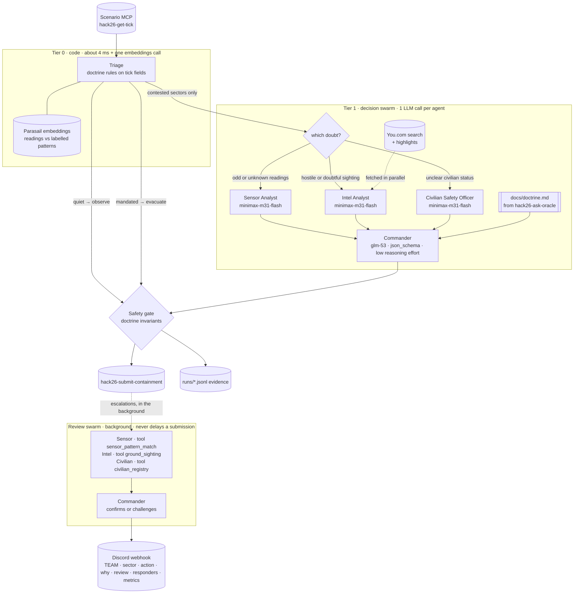

# Halloween Swarm: The Exorcism Protocol

Track 1 entry for **Hack with YOU: Halloween Edition** (team `team-g-aura`).

A CrewAI swarm pulls incident ticks from the scenario MCP feed, decides **contain**, **evacuate** or **observe**
for every sector, submits one action per tick, and alerts `#loft-incident` through the venue Discord webhook only
when a real hazard trips.

**The design rule: code settles what the doctrine already settles, and the swarm handles what needs judgment.**
- **Triage:** every tick is first triaged in code, using Parasail embeddings and the oracle's doctrine. Clear-cut
  sectors are decided in milliseconds.
- **Decision swarm:** ambiguous sectors go to a swarm of role-separated agents, each seeing only its own slice of
  the tick.
- **Review swarm:** every escalation is reviewed in the background by the full swarm, each agent with its own
  tool, before it's posted to Discord.

## Results

| What | Result |
|---|---|
| Live feed, scored by the organizers (`runs/20261028-174930-LIVE.jsonl`) | **3/3 correct, 0 false alarms**: evacuate, evacuate, observe |
| Consistency, 13 repeated fixture runs (including 3 LLM-driven contested runs) | **13/13 identical outcomes**, 0 safety-gate overrides |
| Offline rule tests ([tests/test_rules.py](tests/test_rules.py)) | **24/24 pass** |
| Decision latency on the organizer ticks | **11 ms median** (first tick of a run: about 0.5 s of one-time CrewAI start-up) |
| LLM calls before submitting a clear-cut tick | **0** |

### Bias check: following doctrine, not recalling the known ticks

[scripts/evaluate.py](scripts/evaluate.py) runs the real pipeline (embeddings, triage, swarm, gate) with **no
embedding cache** and never submits. Reports: [seed 2026](docs/evaluation-seed2026.json), [seed 7](docs/evaluation-seed7.json).

| Test | What it would catch | Result |
|---|---|---|
| Cold start on the 3 organizer ticks | answers coming from cached state | 3/3 correct |
| Metamorphic: new sector names, tick and facility ids, sector order, hostile entity names | memorised ids or names | 9/9 decisions unchanged |
| Counterfactuals: unpin civilians, un-breach, remove the sighting | a fixed answer per tick | 4/4 move as the doctrine says |
| Held-out: 80 random ticks (164 sectors) with unseen sectors, entities and readings | tuning to the fixtures | **95/95** doctrine-unambiguous sectors correct, **0 false alarms**, **0 breaches observed** |
| Held-out judgment cases (confidence, witnesses and sensors in tension) | coin-flip decisions | 31/39 → **38/39** (seed 2026) and **30/30** (fresh seed 7), once the doctrine defined "confirmed" (doctrine 7) |
| Ablation: drop the fixture-derived "human-crowd is benign" rule | dependence on knowing the control tick | the swarm judges it itself: observe, no alert, 2/2 |

The evaluation also caught a real over-escalation. The gate allowed evacuating a breach with no sighting at all,
which the oracle calls "evacuation without visual confirmation". It now contains instead, and a test pins it.

## How a tick flows



### Tier 0: triage in code ([triage.py](src/halloween_swarm/triage.py))

One batched embeddings call scores every sector's readings (see [How we use embeddings](#how-we-use-embeddings)).
Then each sector is sorted:

| Tier | Condition (tick fields only) | Action | LLM? |
|---|---|---|---|
| **mandated** | pinned civilians in a breached sector, or a confirmed hostile sighting in a breached sector | evacuate and escalate (doctrine 1) | no |
| **quiet** | no hostile sighting, containment holding, civilians clear, and embedding threat below 0.4 | observe, no alert (doctrine 3 and 5) | no |
| **contested** | everything else | sent to the swarm with the specialists it needs | yes |

"Hostile" excludes `human-crowd` and `residual-echo`, which the oracle calls a "passive replay loop... observe,
log, proceed". A sighting counts as confirmed at 0.6 confidence or higher.

### Tier 1: the decision swarm ([crew.py](src/halloween_swarm/crew.py), [flow.py](src/halloween_swarm/flow.py))

Only the specialists the doubt calls for run, and each sees only the contested sectors:

- **Sensor Analyst:** readings are odd, or there's no embedding match.
- **Intel Analyst:** there's a hostile or doubtful sighting.
- **Civilian Safety Officer:** the status text isn't a clean "clear" or "N pinned", e.g. "2 unaccounted for".

The specialists run concurrently, then the Commander decides. Every agent answers in schema-locked JSON in one call.

### Safety gate ([gate.py](src/halloween_swarm/gate.py))

Applied to every final decision, whoever made it. It reads tick fields only, never tick ids or scenario names:

- Pinned civilians in a breach → evacuate.
- Confirmed hostile breach → evacuate.
- A breach is never observed (observing a breach scores 0) → at least contain.
- Incident-free sector → observe.
- No evacuation without a confirmed sighting, unless civilians are pinned in a breach.
- Observe never escalates.

### Background review swarm

After an escalation is submitted, all four agents review it, each with its own tool and its own slice of the
escalated sector:

| Agent | Tool | Backed by |
|---|---|---|
| Sensor Analyst | `sensor_pattern_match` | Parasail embeddings |
| Intel Analyst | `ground_sighting` | You.com search with highlights |
| Civilian Safety Officer | `civilian_registry` | status parser |
| Commander | (none) | decides whether to confirm or challenge the submitted action, and writes the responder instruction |

The Discord post carries the verdict. Line 1 is the venue's required format; the evidence goes underneath:

```text
team-g-aura · catering_coffee_bar · evacuate · 4 pinned in a breached sector; level-5-phantom @0.91 (4 witnesses); EMF 131 mG, -7 C (~'active manifestation with breach')
tick 143 · score 1 · false alarm: no · decided in 12ms by doctrine triage · peak agents 4/8
Sectors: catering_coffee_bar → evacuate (mandated, ~active manifestation with breach) | entrance → observe (quiet, ~residual echo: mild cold spot, moderate EMF)
Swarm review (civilian officer, sensor analyst, intel analyst, commander): confirmed: Containment is breached with an active manifestation (EMF 131 mG, -7C, 24 motion events) and 4 pinned civilians, making evacuation mandatory per doctrine.
Responders: Evacuate all pinned civilians immediately; do not engage the entity solo.
```

## How we use embeddings

Yes: we convert the sensor numbers into vectors so they can be compared against known situations. Raw numbers
like `EMF 98, temp -4, motion 17` mean little to a model on their own. A similarity score against labelled
examples is something both code and an LLM can act on immediately.

1. **Numbers → descriptive text.** Each reading becomes a short sentence. The coarse words (very high, freezing)
   are added because text-embedding models handle words better than bare digits:
   `EMF 98 milligauss (very high); temperature -4 C (freezing); 17 motion events (moderate movement); containment breached`
2. **Text → vector.** Parasail `parasail-bge-m3` turns each sentence into a 1024-dimensional vector. All of a
   tick's sectors go in one batched call (median 356 ms). The 10 reference patterns are embedded once and cached.
3. **Vector → threat score.** Cosine similarity against the 10 labelled reference patterns in
   [data/sensor_patterns.json](data/sensor_patterns.json): normal crowd, quiet room, electrical noise, two kinds
   of sensor fault, residual echo, early manifestation, active manifestation, and active manifestation with
   breach. Each pattern carries a threat value from 0 to 1. The sector's **embedding threat** is the
   similarity-weighted threat of its 3 nearest patterns.

The resulting `embedding_threat` and nearest-pattern label feed three places:
- **triage:** quiet versus contested
- **the Sensor Analyst's prompt:** the agent gets a scored, labelled comparison rather than raw telemetry
- **the review swarm's `sensor_pattern_match` tool**

Real outputs from the fixtures:

| Tick · sector | Readings | Nearest pattern (similarity) | Embedding threat | Triage |
|---|---|---|---|---|
| 142 · catering_coffee_bar | EMF 98, -4 C, 17 motion, breached | active manifestation with breach (0.926) | 0.86 | mandated (4 pinned) |
| 142 · main_stage | EMF 12, 19 C, 2 motion | normal quiet room (0.967) | 0.14 | quiet |
| 143 · entrance | EMF 44, 11 C, 6 motion + residual-echo @0.35 | residual echo (0.966) | 0.30 | quiet (decoy) |
| 900 · main_stage (control) | EMF 3, 21 C, 41 motion | normal crowd (0.959) | 0.11 | quiet → no alert |
| 9001 · server_closet (synthetic) | EMF 410, 21 C, 0 motion | **sensor fault**: EMF spike, normal temp, no motion (0.979) | 0.33 | quiet: a faulty sensor isn't a ghost |
| 9002 · rooftop_terrace (synthetic) | EMF 118, -6 C, 22 motion | active manifestation (0.958) | 0.63 | contested → swarm |

Similarities sit in a narrow band (0.87 to 0.98), because embedding models compress numeric text. What carries
the signal is the **ranking** of patterns and the weighted threat, not the raw similarity. If the embeddings
call fails, nothing is assumed quiet: every sector becomes contested and the Sensor Analyst judges the raw readings.

## What each LLM actually sees

Evidence is gathered in code first, so every prompt is small and every agent answers in one call.

| Agent | Sees | Doesn't see | Returns |
|---|---|---|---|
| Sensor Analyst | contested sectors' readings and containment state, plus each one's embedding match | sightings, civilians | `SensorReport`: threat 0-1, pattern, evidence |
| Intel Analyst | contested sectors' sightings, plus the You.com results (title, URL, 2 highlights of 300 characters or less) | sensors, civilians | `IntelReport`: credibility, decoy flag, grounding, sources |
| Civilian Safety Officer | civilian status and containment state, only where the text needs reading | sensors, sightings | `CivilianReport` |
| Commander | the three reports, facts parsed in code, and the distilled doctrine | raw telemetry | `TickDecision`: action, escalate and a rationale of 160 characters or less per sector |

Output is constrained by `response_format` `json_schema` (Parasail's server-enforced JSON), so no output needs a
repair call.

## Latency (measured)

From the run logs in `runs/`, on a laptop at the venue:

| Step | Median | Range | Notes |
|---|---|---|---|
| Triage logic (code) | 4 ms | 3-690 ms | upper end includes a cold embeddings call |
| Parasail embeddings call (batched per tick) | 356 ms | 254-673 ms | readings already seen come from cache |
| You.com search (highlights) | 340 ms | 281-989 ms | fetched in parallel for contested sightings |
| **Decide a clear-cut tick** (all organizer ticks) | **11 ms** | 10-445 ms | about 0.5 s on a run's first tick (CrewAI start-up) |
| **Decide a contested tick** (decision swarm) | **2.7 s** | 1.7-4.9 s | 2-3 LLM calls |
| Review swarm per escalation (background) | 7.1 s | 5.2-18.7 s | off the scoring path |
| Feed `get-tick` round trip | about 550 ms | 536-758 ms | MCP over streamable HTTP |

Before the redesign, every tick ran the full swarm with tool loops: about 6 LLM calls and **6-11 s per tick**
(that's the version in the scored live run). One contested tick took 92 s, because glm-53 reasoned for 25k
tokens; `reasoning_effort="low"` brings it to about 1 s with the same answer. The whole outbreak fixture went
from about 25 s to about 1.7 s.

## Why each partner is irreplaceable

| Partner | What it does here | Without it |
|---|---|---|
| **CrewAI** | The Flow that routes every tick (triage → router → swarm → gate), the decision crew on contested sectors, and the review crew on every escalation: role-separated agents with partial views, run concurrently | No routing, no multi-agent judgment, no review of escalations |
| **Parasail** | Embeddings for every tick's triage and the Sensor Analyst's tool; all agent inference, with schema-locked JSON | Triage can't tell normal from fault from manifestation; no reasoning at all |
| **You.com** | Grounds every contested sighting before the Intel Analyst judges it, and is the Intel Analyst's tool in every review | Sightings judged on confidence alone; escalations go out unverified |
| **Discord webhook** | Dispatches escalations built from live tick data and the swarm's verdict, starting with the team handle | Nobody is alerted to pinned civilians |

**One** (withone.ai) was set up, but per the event guide's Track 1 instruction it isn't used for dispatch: its
Discord send returns 401. The venue webhook is the required path.

Every partner call is logged per tick in `runs/*.jsonl` (`partner_calls`, tagged `tick` or `dispatch:<tick_id>`),
with agent, model, latency and status.

## Design decisions (FAQ)

**Isn't triage just hardcoding?** No. Triage applies the oracle's doctrine ([docs/doctrine.md](docs/doctrine.md))
to tick fields and embedding scores. It never looks at tick ids, scenario names or sector names, and a test
greps the decision code to prove it. A new scenario with different sectors, entities and readings goes through
the same rules.

**Then why have a swarm?** The doctrine settles the easy cases: pinned civilians in a breach, or an empty quiet
room. It can't settle a 0.58-confidence poltergeist with rising EMF and no breach, a wraith with "2 unaccounted
for", or a breach with no sighting at all. Those need judgment, so they go to the swarm. Every escalation is also
reviewed by the full swarm.

**Why submit before the review?** The tie-break is "fastest clean run from tick to scoreboard update". The
review can't change a doctrine-mandated action, so it runs in the background and its verdict goes into the post.
If the swarm challenges a decision, the post says so.

**How is `swarm_budget.max_active_agents` respected?**
- Each crew's roster is cut to fit the budget (civilian officer kept first, then sensor, then intel).
- A process-wide agent pool ([budget.py](src/halloween_swarm/budget.py)) makes the decision swarm and any
  background review wait for capacity, so together they never exceed the budget.
- With a budget below 2, contested sectors are decided by the safety gate alone.

**What prevents false alarms?**
- Quiet sectors never reach an LLM.
- The gate forces observe on incident-free sectors and never escalates an observe.
- At most one post goes out per tick, only for the primary sector, and only after the decision is final.

**What if a partner is down?**
- Every call retries once: after `Retry-After` on a 429 (You.com's `X-RateLimit-*` headers are honoured), or
  after a short backoff otherwise.
- Embeddings down: sectors go to the swarm instead of being assumed quiet.
- Swarm fails twice: the gate decides from doctrine.
- Feed down: submissions queue to `queue/pending_submissions.jsonl` and flush on the next run.
- The webhook is never retried after a timeout, so it can't double-post.

## Project layout

| Path | What's in it |
|---|---|
| [main.py](main.py) | One-command entry (`python main.py`) |
| [src/halloween_swarm/main.py](src/halloween_swarm/main.py) | The tick loop: fetch, decide, submit, background review and dispatch, evidence log, scoreboard |
| [src/halloween_swarm/flow.py](src/halloween_swarm/flow.py) | CrewAI Flow per tick: triage → router → decision swarm → safety gate |
| [src/halloween_swarm/triage.py](src/halloween_swarm/triage.py) | Tier 0 sorting into mandated / quiet / contested |
| [src/halloween_swarm/signals.py](src/halloween_swarm/signals.py) | Embedding pattern match and You.com grounding |
| [src/halloween_swarm/crew.py](src/halloween_swarm/crew.py) | Decision crew and review crew |
| [src/halloween_swarm/config/](src/halloween_swarm/config/) | Agent roles and task prompts (YAML) |
| [src/halloween_swarm/tools.py](src/halloween_swarm/tools.py) | The review agents' tools |
| [src/halloween_swarm/gate.py](src/halloween_swarm/gate.py) | Deterministic doctrine invariants |
| [src/halloween_swarm/budget.py](src/halloween_swarm/budget.py) | Process-wide agent pool |
| [src/halloween_swarm/partners.py](src/halloween_swarm/partners.py) | You.com, Parasail embeddings and webhook calls, retries, evidence ledger |
| [src/halloween_swarm/feed.py](src/halloween_swarm/feed.py) | Scenario MCP client (`MCPServerHTTP` config), fixture replay, offline submission queue |
| [data/sensor_patterns.json](data/sensor_patterns.json) | Seeded, labelled reference readings for the embedding step |
| [docs/doctrine.md](docs/doctrine.md) | Oracle answers and the distilled doctrine the swarm follows |
| [docs/tools.md](docs/tools.md) | The scenario MCP's tool schemas |
| [fixtures/](fixtures/) | Organizer fixtures, plus our `contested-synthetic.json` to exercise the swarm |
| [tests/test_rules.py](tests/test_rules.py) | 24 offline rule tests |
| [scripts/evaluate.py](scripts/evaluate.py) | Bias and generalisation evaluation: cold start, metamorphic, counterfactual, held-out, ablation |
| [runs/](runs/) | Evidence logs; the scored live run is committed |

## Setup

```bash
uv venv --python 3.12 .venv && source .venv/bin/activate
uv pip install -r requirements.txt
cp .env.example .env   # then fill in the values
```

[.env.example](.env.example):

```text
YDC_API_KEY=""
PARASAIL_API_KEY=""
DISCORD_WEBHOOK_URL=""
TEAM=""
TEAM_TOKEN=""
SCENARIO_MCP="https://api.you.com/mcp/halloween-hack-26"
```

Run the rule tests (offline: doctrine invariants, budget, message format, no hardcoding, no secrets):

```bash
uv pip install -r requirements-dev.txt && python -m pytest -q
```

Check the credentials and the feed (read-only; nothing is submitted or posted):

```bash
python scripts/check_setup.py   # You.com, Parasail chat + embeddings
python scripts/probe_feed.py    # tool schemas -> docs/tools.md, oracle doctrine -> docs/doctrine.md
```

## Run it (one command)

```bash
python main.py
```

| Command | Feed | Submits | Posts |
|---|---|---|---|
| `python main.py --fixture fixtures/outbreak-level-5.json` | organizer fixture, offline | no | no |
| `python main.py --fixture fixtures/control-tick.json` | organizer fixture, offline | no | no |
| `python main.py --fixture fixtures/contested-synthetic.json` | our ambiguous ticks, to exercise the swarm | no | no |
| `python main.py --dry-run` | live (advances the team's tick cursor) | no | no |
| `python main.py` | live | yes | only on escalation |

The loop runs get-tick, triage, the swarm (if contested), the gate, submit and the background review, and repeats
until the feed reports `exhausted: true`. Then it prints the scoreboard.
